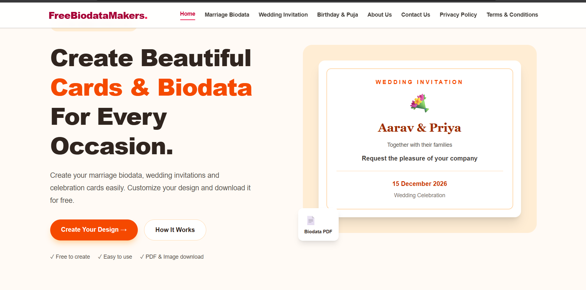
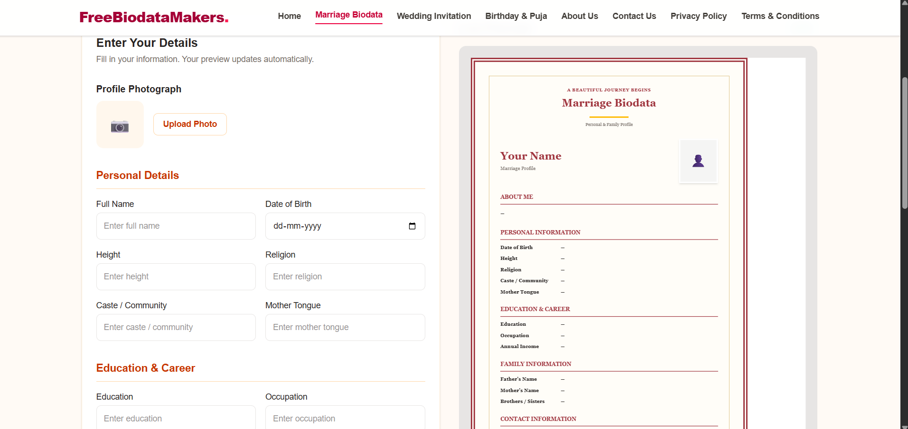
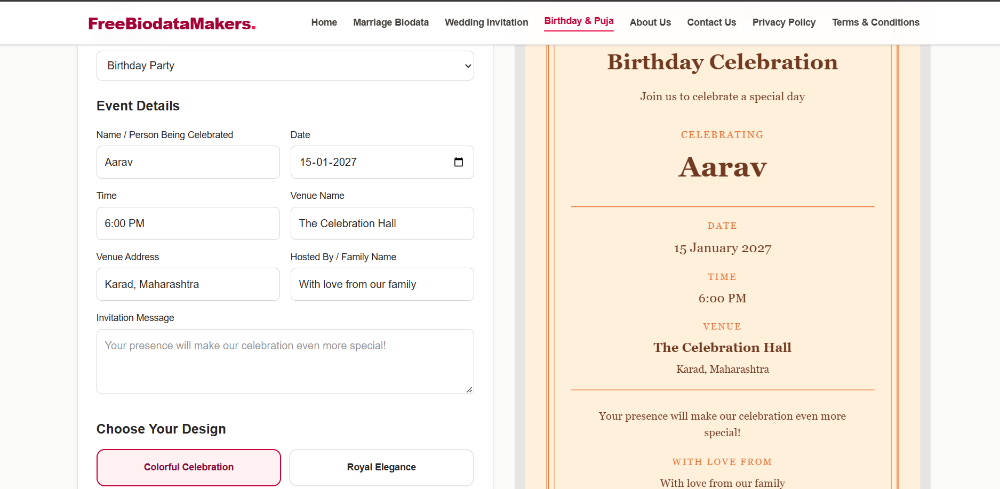

# Free Biodata Makers

Create beautiful Indian marriage biodata, wedding invitations, birthday cards, and puja invitations — completely free.

🌐 Official Website

https://freebiodatamakers.com


## 🚀 Live Demo

**[Visit Free Biodata Makers](https://free-biodata-makers.pranavkumbhar20042884.workers.dev)**

## 📸 Website Screenshots

### Homepage


### Marriage Biodata Maker


### Wedding Invitation Maker


## ✨ Features

- Marriage Biodata Maker with multiple templates
- Wedding Invitation Maker
- Birthday and Puja Card Maker
- English, Hindi, and Marathi language support
- PDF and PNG downloads
- Photo upload and live preview
- Mobile-friendly responsive design

## 🛠️ Tech Stack

- Next.js
- React
- TypeScript
- Tailwind CSS
- Cloudflare Workers
- Vinext

## 💻 Run Locally

Clone the repository:

```bash
git clone https://github.com/Pranavk-07/free-biodata-makers.git
```

Navigate into the project:

```bash
cd free-biodata-makers
```

Install dependencies:

```bash
npm install
```

Start the development server:

```bash
npm run dev
```

Open http://localhost:3000 in your browser.

## 🌐 Deployment

Deployed using Cloudflare Workers.

## 📬 Contact

Email: freebiodatamakers@gmail.com

## 📄 License

This project is currently maintained by its creator.
